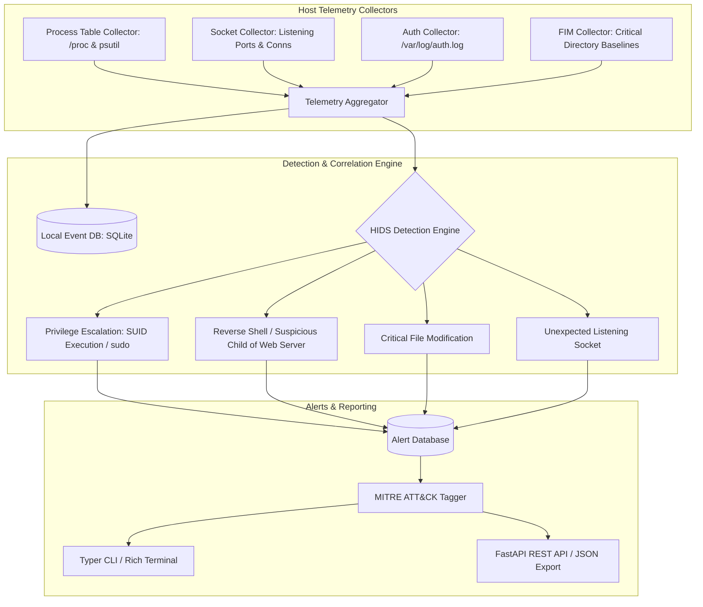

# Host Intrusion Detection System (`hids`)

Lightweight Host Intrusion Detection System (HIDS) with File Integrity Monitoring, Process Anomaly Detection, Authentication Log Parsing, and MITRE ATT&CK Mapping.

[](https://github.com/Krish9800/host-intrusion-detection-system/actions)
[](LICENSE)
[](https://www.python.org/)
[](https://www.kernel.org/)
[](https://typer.tiangolo.com/)

---

## Overview & Problem Statement

Perimeter defenses frequently fail against identity compromise or zero-day exploits. Once an adversary gains initial host access, security visibility depends entirely on endpoint sensors that continuously detect privilege escalation, modified binaries, unauthorized network sockets, and suspicious child processes.

**Host Intrusion Detection System (`hids`)** is an agentic endpoint security monitor built in Python 3.12. It inspects local system processes, monitors listening network sockets, tracks file integrity across critical configuration directories, parses Linux authentication events, evaluates host telemetry against heuristic threat rules, and maps suspicious indicators to MITRE ATT&CK tactics.

---

## Architecture & Data Flow



---

## Verified Features

- **Process Anomaly Detection:** Identifies suspicious process hierarchies (e.g., `www-data` or `nginx` spawning `/bin/bash` or `/bin/sh`).
- **File Integrity Monitoring (FIM):** Cryptographically baselines and verifies critical directories (`/etc`, `/bin`, `/usr/bin`) to detect unauthorized modifications.
- **Listening Socket Auditing:** Continuously monitors listening TCP/UDP ports and flags unexpected network binds.
- **Authentication Log Forensics:** Analyzes `/var/log/auth.log` for brute-force SSH logins and unauthorized `sudo` attempts.
- **MITRE ATT&CK Tagging:** Associates host alerts directly with enterprise ATT&CK techniques (T1059, T1078, T1046, T1548).
- **Dual Interface:** High-speed Typer CLI for local audits, plus a FastAPI control plane.

---

## Technology Stack

- **Runtime:** Python 3.12+
- **Process & System Metrics:** `psutil`
- **Data Storage:** SQLite 3
- **Data Validation:** Pydantic v2
- **CLI Framework:** Typer & Rich
- **API Framework:** FastAPI & Uvicorn
- **Quality Gates:** Pytest, Ruff, Mypy, Bandit

---

## Requirements & Installation

```bash
# Clone the repository
git clone https://github.com/Krish9800/host-intrusion-detection-system.git
cd host-intrusion-detection-system

# Create and activate virtual environment
python3 -m venv .venv
source .venv/bin/activate

# Install dependencies
pip install -e .
```

---

## Verified Usage Examples

### 1. Command-Line Interface (CLI)

```bash
# Initialize local SQLite event database
hids init-db

# Run a file integrity scan across /etc
hids fim-scan /etc

# List active host security alerts
hids alerts

# Display collected host security events
hids events

# List active HIDS heuristic detection rules
hids rules
```

### 2. REST API Service

```bash
# Launch the HIDS local daemon
uvicorn hids.api.app:app --host 127.0.0.1 --port 8000
```

Endpoints available at `http://127.0.0.1:8000/docs`:
- `GET /health` — Service health check
- `GET /alerts` — List detected host intrusion alerts
- `GET /events` — Query raw normalized host telemetry
- `GET /fim/baselines` — Query file integrity baseline hashes

---

## Testing & Quality Gates

```bash
# Run unit and integration tests
pytest --cov=hids --cov-report=term-missing

# Linting and static analysis
ruff check .
ruff format --check .
mypy src/hids
```

---

## Security Model & Threat Boundaries

- **Read-Only Telemetry:** Collects system metrics via unprivileged `/proc` read operations and standard system logs without kernel hooking.
- **Local Isolation:** SQLite storage ensures host telemetry is preserved locally without transmitting system credentials to external cloud services.

---

## Limitations & Known Issues

- **Kernel Rootkits:** Kernel-level rootkits that hook syscalls before `/proc` can theoretically conceal processes; detection relies on user-space telemetry.
- **Privilege Requirements:** Reading restricted auth logs (`/var/log/auth.log`) requires membership in the `adm` group or read permissions.

---

## License & Responsible Use

This project is released under the **MIT License**.

> [!NOTE]
> Designed for Linux system administrators, host defense analysts, and blue-team endpoint security researchers.
